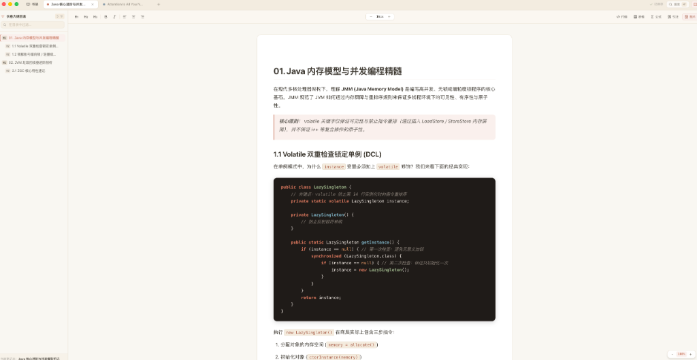
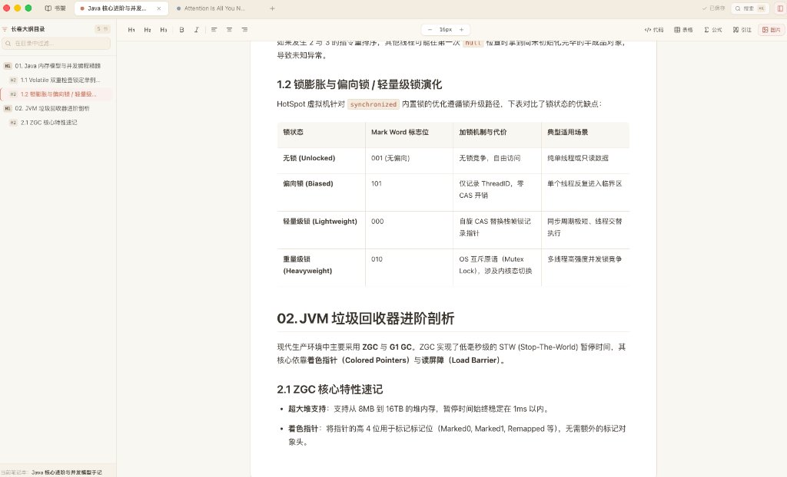

<div align="center">


# QNote

**专为学术论文研读与编程深度学习打造的极简、抗臃肿 macOS 暖纸手帐长卷笔记软件**

[-E8DFD1?style=flat-square&logo=apple&logoColor=38332B)](https://github.com/LIKEASHOT/QNote)
[](https://react.dev)
[](https://www.typescriptlang.org)
[](https://tailwindcss.com)
[](https://tiptap.dev)
[](LICENSE)

<p align="center">
  <a href="#-设计哲学与灵感">设计哲学</a> •
  <a href="#-核心特性一览">核心特性</a> •
  <a href="#-功能界面展示">界面展示</a> •
  <a href="#-快捷键矩阵">快捷键</a> •
  <a href="#-安装与本地构建">安装与构建</a> •
  <a href="#-数据格式与本地所有权">数据所有权</a>
</p>

</div>

---

## 📖 设计哲学与灵感

市面上现存的绝大多数笔记软件（如 Notion、Obsidian、OneNote）功能日趋庞杂臃肿，深层文件夹嵌套、复杂的数据库属性和沉重的加载等待极大地干扰了学习心流。

**QNote** 应运而生。它旨在为研究人员、学生与工程师提供一个**轻量、专注、具温润书卷气质**的纯粹学习空间：

1. **天然纸张质感（Warm Parchment Aesthetic）**：告别刺眼高对比度的纯白（`#FFFFFF`）与生硬死黑。全屏选用温暖自然的天然纸张底色（`#FAF7F2`）搭配铅字沉淀感的暖炭油墨字（`#38332B`）与 Claude 标志性陶土橙（`#C97B63`）点睛，长时间研读论文注视不易疲劳。
2. **单本即长卷（Continuous Canvas）**：彻底摒弃一页一页物理分页或多层级文件夹的束缚。一个笔记本就是一幅向下无限延展的知识长卷，通过层级大纲目录实现全景定位。
3. **原生 macOS 体验**：专为 macOS 打造，无缝融入红绿灯标题栏、丝滑窗口拖拽与双击最大化缩放，搭配 3D 纯净镂空手帐 Dock 图标。

---

## ✨ 核心特性一览

- 📚 **笔记本书架与多标签联动**：顶栏常驻书架图标，支持类似浏览器的多笔记本标签页即时切换；书架网格陈列各色手帐，支持自定义莫兰迪自然色系封面（陶土橙、鼠尾草绿、雾霾蓝、暖金、复古肉桂等）。
- 📝 **连续长卷与多级标题**：完整支持 `Cmd + 1` 到 `Cmd + 6` 一键设为对应层级标题，`Cmd + 0` 快速还原正文段落。
- 📑 **双向滚动跟随大纲（Scroll Spy）**：左侧智能提取 H1~H6 树形大纲，长文滚动时目录自动呈现陶土高亮跟随；支持小三角折叠子章节与快速搜索过滤，按 `Cmd + \` 随时隐匿大纲进入专注模式。
- ⚡ **智能代码粘贴与防误判还原**：从 IDE 或网页粘贴 Java、Python、SQL、TypeScript、Rust 等代码时，自动推断语言并包裹为语法高亮代码块；浮现微型控制胶囊，支持一键「还原为纯文本（或按 Cmd+Z）」。
- 📊 **智能表格自动转换**：从网页、Excel 或 Numbers 复制的表格粘贴时，自动转为可交互、自由增删行列的纸质风格富文本表格。
- 📐 **内置 KaTeX 学术数学公式**：专为学术论文打造，支持行内 `$math$` 与跨行 `$$math$$` 高清公式渲染，内置可视化 LaTeX 公式插入器。
- 🖼️ **截图即粘与图片支持**：直接按下 `Cmd+Shift+4` 截图后，在笔记中按 `Cmd+V` 即可直接嵌入图片。
- 🔍 **全局 Spotlight 检索**：按下 `Cmd + K` 随时呼出全局检索浮窗，跨笔记本即时模糊匹配标题与正文段落。

---

## 🖥️ 功能界面展示

### 1. 手帐书架与标签页管理
温润优雅的书架网格，直观展示正在研读的专业笔记本，可自由设定手帐封面色彩与学习目标：

<div align="center">
  
</div>

---

### 2. 连续长卷编辑器、实时大纲与智能代码块
单篇无限延展的长卷设计，左侧目录与阅读位置实时双向高亮跟随，智能语法高亮代码块让技术笔记清晰有条理：

<div align="center">
  
</div>

---

### 3. 结构化纸质表格与重点注记
从 Excel/网页复制的数据可自动转为交互表格，重点结论通过陶土橙高亮引用块深度沉淀：

<div align="center">
  
</div>

---

## ⌨️ 快捷键矩阵

| 快捷键 | 功能动作 |
| :--- | :--- |
| `Cmd + 1` ~ `Cmd + 6` | 将当前行/选中文本快速转换为 1 ~ 6 级标题，大纲实时同步更新 |
| `Cmd + 0` | 转换恢复为普通正文段落 |
| `Cmd + B` / `Cmd + I` | 粗体 / 斜体 |
| `Cmd + \` | 随时展开 / 收起左侧大纲目录栏，进入无干扰全屏书写 |
| `Cmd + F` | 全局呼出 Spotlight 风格即时搜索面板（亦支持 `Cmd + K`） |
| `双指捏合 / 张开` | 触控板手势：平滑无级放大或缩小当前笔记长卷页面 |
| `Cmd + +` / `Cmd + -` | 放大 / 缩小页面（支持点击右下角百分比或 `Cmd + 0` 快速重置 100%） |
| `Cmd + T` | 快速前往笔记本书架 |
| `Cmd + W` | 关闭当前打开的笔记本标签页 |
| `Cmd + V` | 智能粘贴（自动检测代码块、表格、截图图片） |
| `Cmd + Z` / `Cmd + Shift + Z` | 撤销 / 重做（智能包裹代码块后按 Cmd+Z 可一键撤销为纯文本） |

---

## 🚀 安装与本地构建

### 前置环境需求
- macOS 12+ (Apple Silicon M 系列及 Intel 均支持)
- Node.js >= 18
- pnpm (推荐 `pnpm v11+` 或 `npm`)

### 1. 克隆项目与安装依赖
```bash
git clone https://github.com/LIKEASHOT/QNote.git
cd QNote

# 安装依赖
pnpm install
```

### 2. 本地调试开发
```bash
# 启动前端热重载开发模式
pnpm dev

# 启动桌面端独立视窗开发
pnpm app
```

### 3. 打包生成 macOS 原生 `.app`
```bash
# 一键编译、构建并打包至 release 目录
chmod +x scripts/bundle-app.sh
./scripts/bundle-app.sh
```
打包成功后，将在 `release/QNote-darwin-arm64/` 目录下生成 `QNote.app`。可直接将其拖入 `/Applications`（应用程序）中运行！

---

## 🔒 数据格式与本地所有权

QNote 坚守**数据 100% 归属用户**原则：
- **无私有格式锁定**：笔记本数据基于本地开放存储，可天然接入系统的 **Time Machine**、**iCloud Drive** 或 **Git** 进行版本追踪与多端备份；
- **纯净离线**：不依赖任何中心化远程服务器，断网环境依然毫秒级冷启动运行。

---

## 🛠️ 技术栈

- **桌面运行时**：[Electron](https://www.electronjs.org/) (macOS Native Frameless Window & MachPort Rendezvous)
- **前端架构**：[React 18](https://react.dev/) + [TypeScript](https://www.typescriptlang.org/) + [Vite](https://vite.dev/)
- **富文本引擎**：[TipTap](https://tiptap.dev/) / [ProseMirror](https://prosemirror.net/)
- **设计系统**：[Tailwind CSS](https://tailwindcss.com/)（严格映射 `CLAUDE_DESIGN_SYSTEM.md` 暖纸调色板）
- **图标与数学引擎**：[Lucide React](https://lucide.dev/) + [KaTeX](https://katex.org/)
- **状态管理**：[Zustand](https://github.com/pmndrs/zustand)

---

## 📄 开源许可证

本项目基于 [MIT 许可证](LICENSE) 开源。

Copyright (c) 2026 [LIKEASHOT](https://github.com/LIKEASHOT).
